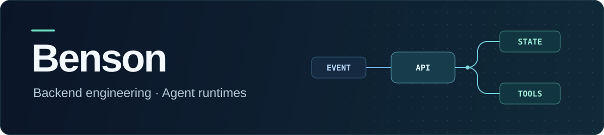

  

## 👋 你好，我是 Benson

我在做 **Java 后端与 Python Agent 工程**。这里记录即时通信、Agent 运行时、多 Agent 客服，以及后端面试复盘。

## 公开仓库

截至 2026-11-27，我有 **7 个公开仓库**。[查看 GitHub 仓库列表 ↗](https://github.com/wbx295264-lab?tab=repositories)

| 仓库 | 简介 |
| :--- | :--- |
| [InfiniteChat](https://github.com/wbx295264-lab/InfiniteChat) | 基于 Spring Boot 的即时通信后端，涵盖消息收发、实时连接和离线存储。 |
| [BearCode](https://github.com/wbx295264-lab/BearCode) | Python Agent 运行时，提供 Web 工作台和 CLI。 |
| [EchoMind](https://github.com/wbx295264-lab/EchoMind) | 多 Agent 客服后端，包含意图识别、知识库检索和转人工流程。 |
| [NexusOps](https://github.com/wbx295264-lab/NexusOps) | 面向客服场景的 Python Agent 后端。 |
| [bagu](https://github.com/wbx295264-lab/bagu) | 后端面试复盘和项目问答。 |
| [all_projects_code_zip](https://github.com/wbx295264-lab/all_projects_code_zip) | 项目代码压缩包归档。 |
| [wbx295264-lab](https://github.com/wbx295264-lab/wbx295264-lab) | 这个 GitHub 主页的 README 和横幅。 |
