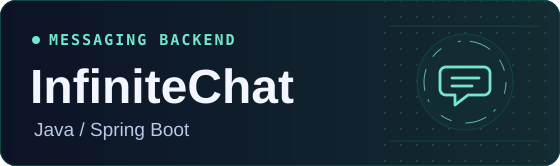
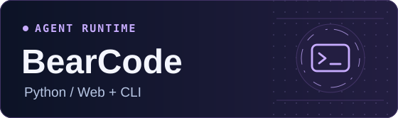
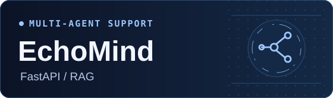
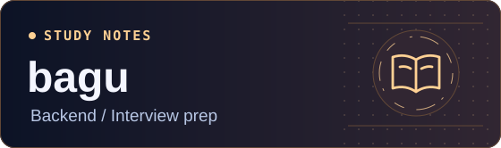

<p align="center">
  
</p>

<p align="center"><strong>👋 我是 Benson。</strong> 我做即时通信后端，也研究如何让 Agent 调用工具、管理会话和协作。</p>

<p align="center">
  <a href="#-项目工坊">🧩 项目工坊</a> ·
  <a href="#-技术栈">🛠️ 技术栈</a> ·
  <a href="#-本地运行台">⚡ 本地运行台</a> ·
  <a href="#-开发动态">📈 开发动态</a>
</p>

## 🧩 项目工坊

<table>
  <tr>
    <td width="50%" valign="top">
      <a href="https://github.com/wbx295264-lab/InfiniteChat"></a><br />
      💬 从用户认证到消息收发、实时通信和离线存储，按服务拆分的 Spring Boot 后端。
    </td>
    <td width="50%" valign="top">
      <a href="https://github.com/wbx295264-lab/BearCode"></a><br />
      🐻 Web 工作台与 CLI 共用一套 Agent 运行时，支持工具执行、权限确认和会话恢复。
    </td>
  </tr>
  <tr>
    <td width="50%" valign="top">
      <a href="https://github.com/wbx295264-lab/EchoMind"></a><br />
      🧠 从意图识别和知识库检索到 Agent 路由、转人工与对话质量评测。
    </td>
    <td width="50%" valign="top">
      <a href="https://github.com/wbx295264-lab/bagu"></a><br />
      📚 后端面试复盘和项目问答，整理实现细节与常见追问。
    </td>
  </tr>
</table>

## 🛠 技术栈

**☕ 后端与服务**


**🤖 Agent 与工具**


## ⚡ 本地运行台

<a href="https://github.com/wbx295264-lab/BearCode">
  
</a>

<details>
  <summary>⌨️ 展开启动命令</summary>

完成 [BearCode 环境配置](https://github.com/wbx295264-lab/BearCode) 后，在仓库根目录运行其中一条命令。

```bash
python -m agents.web   # Web 工作台
python -m agents.main  # CLI
```

</details>

## 📈 开发动态

<a href="https://github.com/wbx295264-lab#js-contribution-activity">
  
</a>

[](https://github.com/wbx295264-lab/InfiniteChat/commits/main/)
[](https://github.com/wbx295264-lab/BearCode/commits/main/)
[](https://github.com/wbx295264-lab/EchoMind/commits/main/)
